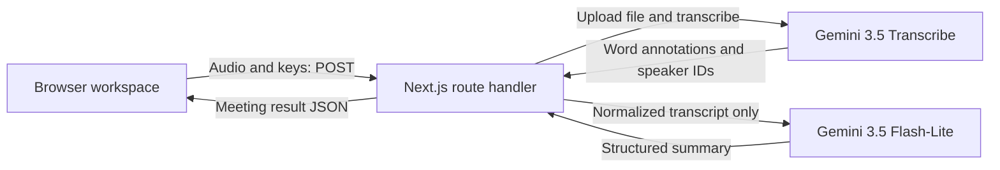

# Technical Design — Solution Overview

Date: 2026-11-05  
Status: Draft for review; no implementation authorization implied.  
Requirements: [PRD v2.3](PRD.md); [resolved requirement findings](Requirement-Findings.md).

## Recommended direction

Keep the existing Next.js application. Add a client-side meeting workspace and one server-side POST endpoint that accepts audio and one user-supplied Gemini API key. The endpoint uploads audio through Gemini Files API, calls Gemini 3.5 Transcribe for a completed transcription, normalizes speaker-attributed segments, requests a structured Gemini 3.5 Flash-Lite summary, and returns one application-owned JSON result.

The browser sees one request and a generic processing indicator. Any Gemini file-readiness wait happens inside that request; it does not require an application queue, database, worker, webhook, or browser polling endpoint. Audio and results remain in application memory. Keys persist in the user’s browser localStorage for demo reuse; the server holds them only within the active request. Temporary remote provider resources are a separate boundary and receive best-effort cleanup.

This direction preserves the accepted one-page interface, fixed models, shared Record/Upload pipeline, optional preview, 20 MiB audio cap, five-minute recording limit, and user-owned runtime verification. It does not claim that all five-minute recordings complete within a measured time.

## Repository evidence

- [package.json](../package.json) declares Next.js 16.4.5, React 19.3.0, TypeScript, Tailwind 4, and Bun 1.4.3. No provider SDK or validation library is installed.
- Repository snapshot at provider revision: current code implements the previous two-provider flow: [route](../app/api/process-meeting/route.ts), [workspace](../components/MeetingWorkspace.tsx), [Soniox adapter](../lib/meeting/soniox.ts), and [summary adapter](../lib/meeting/gemini.ts). Migrate this code in place, preserving unrelated workspace changes. This design supersedes its two-key/Soniox behavior.
- [app/layout.tsx](../app/layout.tsx) owns the root shell/fonts. [app/globals.css](../app/globals.css) currently follows system dark mode; the demo should use the PRD's light appearance.
- [next.config.ts](../next.config.ts) already enables cache components and Turbopack CSS processing. Preserve framework configuration unless implementation reveals a concrete incompatibility.
- The installed Next.js [route-handler guide](../node_modules/next/dist/docs/01-app/03-api-reference/03-file-conventions/route.md) documents `request.formData()` and `Response.json()`. Use a Route Handler, not Pages Router body-parser configuration or a Server Action. Request-specific provider calls must not enter cached functions.

These are inspected facts. All behavior below is proposed design, not observed implementation.

## Boundaries and flow

Use a small client workspace beneath the existing page/root layout, a route at `app/api/process-meeting/route.ts`, and a small server-only provider/normalization module if needed for readability. Shared result types can live in one dependency-free module. This is a boundary recommendation, not a task/file checklist. Use native fetch and Web APIs; adding provider SDKs or a state-management dependency has no demonstrated benefit for this narrow flow.

### Browser ownership

Keep one Gemini API key in a password input and persist it under `meeting-assistant.geminiApiKey`. No second credential is needed. Retire any legacy Soniox input/request field/storage constant; remove only the app-owned legacy entry `meeting-assistant.sonioxApiKey` on mount as best-effort migration without reading or sending its value. Preserve any existing Gemini entry. Read storage only after client mount; initialize the workspace without browser API access during server rendering. Complete the initial read before enabling edits or write effects, so empty initial state cannot overwrite saved keys. Save on user edits; empty input removes the corresponding entry. “Clear saved keys” removes the Gemini entry and clears its input; disable it during processing. Do not clear unrelated browser storage, synchronize across tabs, introduce expiry/encryption infrastructure, or persist audio/results. Catch read/write/remove exceptions: continue with in-memory keys and a visible save/clear failure message, without claiming stored data was removed if removal failed. Do not run mount-time storage writes that could restore values after a clear. Keys persist across refresh and browser reopening on the same origin; another port/origin has separate storage. No cookies or key-bearing URLs are needed. Keep one selected File/Blob shared by both input methods. Switching input methods while idle clears the previous audio and results, avoiding hidden competing recordings/files.

Recording uses `getUserMedia` and `MediaRecorder` on desktop Chrome, preferring supported WebM/Opus. Check capabilities before starting; present microphone-denial or unsupported-browser errors in place. No audio leaves the browser until Process Meeting. Collect chunks in memory, stop at five minutes, and finalize the Blob only after the recorder's final data event. Track cumulative bytes; stop and reject an oversized recording rather than offer an incomplete recording for processing. Always stop microphone tracks when recording ends or the workspace unmounts. Revoke object URLs on replacement/unmount if optional native audio preview is implemented.

Require a nonempty Gemini key and a finalized nonempty audio input before submitting. Apply the 20 MiB check locally for feedback and repeat it on the server. Disable processing during recording. An immediate in-flight guard, alongside disabled controls, prevents rapid duplicate submissions from one workspace. While processing, lock keys and input controls as required. Keep the selected filename, or a simple recording label, visible.

Clear prior result/error on audio replacement or a new attempt. A monotonically increasing local attempt identifier prevents a superseded response from replacing current state if cleanup/unmount races occur. Refresh loses audio, results and processing state; saved keys are restored. No meeting recovery/history is promised.

### UX presentation

Implement the accepted refinements in PRD §4.2 within existing state and native HTML controls. Display the currently missing processing prerequisite beside the disabled button. Show upload formats/size/recommended length, selected filename/size, and recording elapsed time against `05:00`. Explain valid auto-stop and input-tab clearing inline. Show English UI copy while preserving meeting-language summaries.

Keep summary and transcript visible; use native `details`/`summary` for Raw JSON, initially collapsed. Render explicit successful-empty messages rather than blank lists and a distinct partial-summary warning with full-pipeline retry wording. Place actionable errors near the affected section; suggest Upload Audio for microphone denial and replacement audio for no speech. The processing button reads “Processing…” with keep-page-open guidance. A single pending POST cannot expose actual provider stages, so do not simulate them or estimated percentages. An elapsed timer remains optional and must not be announced every second. Use visible field labels, focus styles, text plus speaker colors, a polite status region and appropriate error alerts.

Native audio preview and Copy JSON remain optional P1. Preview uses one object URL, native `audio controls`, no autoplay, and cleanup on replacement/unmount; a browser playback failure does not imply Gemini cannot decode the file. Clipboard writing uses the same serialized result as Raw JSON, reports success only after fulfillment, and falls back to selectable JSON with a readable error. No libraries or new backend endpoints are needed.

Configuration helper copy explains browser key saving and the Gemini STT/summary data flow. No automatic collapse of configuration, wizard or confirmation modal is introduced.

### Server ownership and input boundary

`POST /api/process-meeting` receives multipart `audio` and `geminiApiKey`. Use a server Route Handler with the default Node.js runtime behavior; run locally through the existing Bun scripts. No Edge deployment or separate backend is proposed.

Validate form shape, a nonempty Gemini key, nonzero audio size, the 20 MiB file cap, and the allowed MP3/WAV/M4A/WebM input set before provider calls. Browser MIME labels can be missing or generic, so allow an appropriate filename extension when MIME metadata is inconclusive; reject contradictory unsupported types. MIME/extension checks are screening, not proof of decodability: provider decode failures become a readable invalid-audio error. No transcoding, filesystem staging, or media-probing dependency is needed.

The exact cap applies to the audio part, not multipart overhead. `formData()` may buffer before file validation; this design enforces the cap before contacting providers, not as an adversarial streaming memory bound. The trusted local demo does not require a hardened public upload gateway. If deployed later, host/proxy body limits and deadlines need separate assessment.

### Gemini 3.5 Transcribe integration

The user-selected fixed STT model is `gemini-3.5-transcribe`. Use Gemini Files API upload (resumable initialization plus upload/finalize) from in-memory bytes, not inline base64: a 20 MiB audio cap can exceed an inline request budget after base64 expansion. Use `x-goog-api-key` header authentication. Keep the returned file name for deletion and URI/MIME type for inference. Check file state and, if needed, wait for ACTIVE within the STT deadline; FAILED is an error. This is file readiness, not a Soniox-style transcription job. See [Files API](https://ai.google.dev/gemini-api/docs/files).

Use one foreground, non-streaming `POST https://generativelanguage.googleapis.com/v1beta/interactions` with model `gemini-3.5-transcribe`, `store: false`, and audio input `{type: "audio", uri: fileUri, mime_type: canonicalMime}`. Use the documented Interactions REST revision (`Api-Revision: 2026-05-20` in the inspected Files REST example) and response contract consistently; recheck the reference if the chosen endpoint requires another revision; do not mix Generate Content camelCase config with Interactions snake_case. No `previous_interaction_id`, background mode, live model or interaction polling. Stateless storage is documented in the [Interactions guide](https://ai.google.dev/gemini-api/docs/interactions).

Set `generation_config.transcription_config.mode` to `{type: "verbatim", diarization_mode: "speaker", timestamp_granularities: ["word"]}`. Omit language restrictions to allow Vietnamese/English code-switching. Do not enable smart mode or custom vocabulary; these conflict with the required attribution/timing features. The [Transcribe guide](https://ai.google.dev/gemini-api/docs/transcribe) documents the config, supported MP3/WAV/M4A/WebM MIME types and word annotations. Canonicalize browser metadata (for example `audio/webm;codecs=opus` to `audio/webm`, M4A to `audio/m4a`) after input validation; do not transcode or rename unsupported content as a supported codec.

Read text and `word_info` annotations from completed model-output text content in `steps`, according to the current REST reference. Parse `start_offset`/`end_offset` duration strings such as `0.100s` into milliseconds. Reject malformed/missing timing for recognized words, not fabricate timestamps. Stable-sort by start offset and group adjacent words by speaker, splitting at substantial pauses. Use word-aware spacing/punctuation rather than the old Soniox subword concatenation rule. Map actual speaker IDs by first occurrence to Speaker 1, Speaker 2, etc.; missing attribution stays Unknown speaker. A completed empty transcript with no words is no_speech; nonempty text with unusable annotations is an integration error, not silence. Safety-blocked/truncated/noncompleted output is an STT failure.

Documented limits: at most 8 speakers; attribution for 3+ is experimental; timestamps can reduce recognition accuracy; diarization/timing audio is limited to 30 minutes. Keep the product's five-minute upload recommendation and handle duration rejection as a readable error, without local duration probing or chunking. Account access and quality remain unverified.

### Gemini 3.5 Flash-Lite summary integration

Use fixed `gemini-3.5-flash-lite` through `POST https://generativelanguage.googleapis.com/v1beta/models/gemini-3.5-flash-lite:generateContent`, the documented Generate Content REST interface with API-key authentication in `x-goog-api-key`. Google currently lists it as a stable Flash model in its [model catalog](https://ai.google.dev/gemini-api/docs/models); account access remains unverified. Keep model identifiers in server constants, with no selector or fallback model discovery.

Send the complete normalized transcript with speaker labels and relative timestamps; do not send audio, either provider key in prompt content, or provider administration metadata. Use system instructions to treat meeting text as data, ignore embedded instructions, distinguish proposals from agreed decisions, and extract only explicit commitments. Specify the PRD language rule, Unknown assignees, and verbatim relative deadlines. Gemini chooses the dominant language, falling back to the first substantive utterance; no additional language service is necessary.

Request JSON constrained to discussions, decisions, and action items (assignee/task/deadline) using the supported structured-output configuration. Follow the current [Generate Content structured-output reference](https://ai.google.dev/gemini-api/docs/generate-content/structured-output) rather than mixing SDK and REST field names. Validate parsed values at runtime with small explicit guards; TypeScript types alone do not validate an external response. Missing fields, wrong types, blocked/no candidate responses, truncation, and provider errors all produce `summary_failed` while preserving transcript. Do not silently repair a malformed response into a successful empty summary or add another generation pass.

Structured output constrains format, not factual accuracy. Prompt grounding and shape validation cannot guarantee the absence of invented conclusions; assessment of semantic accuracy remains part of the user's experiment.

## Result contract and failure semantics

The application owns one normalized result used by the UI and Raw JSON. “Raw JSON” means the application integration result, not an unrestricted dump of provider HTTP responses. It contains status, normalized transcript segments, and a nullable summary containing discussions, decisions, and action items. Include a safe summary-error message on partial failure. Keep provider tokens and credential-bearing payloads internal.

| Outcome | Response | Presentation |
| --- | --- | --- |
| Transcription and valid summary succeed | HTTP 200, `completed`, transcript, summary | Summary first, then decisions/action items, transcript, JSON |
| Transcript succeeds; summary fails or output is invalid | HTTP 200, `summary_failed`, transcript, summary `null` | Explicit warning, usable transcript and JSON |
| No recognized speech | HTTP 200, `no_speech`, empty transcript, summary `null` | No speech detected; no invented summary |
| Invalid input or transcription fails/times out | Non-2xx, safe error message | Error; no stale result |

Valid empty decision/action lists are different from unavailable summary. Unknown assignees and Not specified deadlines are explicit strings; transcript speaker identity is never inferred from a named task assignee. Raw JSON and displayed content derive from the same object, avoiding divergent normalization.

A normal browser attempt cannot overlap another in that workspace. This is not server-wide deduplication: another tab, a direct API call, or manual retry can create another inference request and incur another charge. No idempotency store is justified by this demo's scope.

## Deadlines, cleanup, and privacy

Choose bounded defaults: 180 seconds for file upload and transcription including file-readiness waiting, then up to 60 seconds for summary; allow up to 10 additional seconds for cleanup. These are proposed patience limits, not measured service guarantees. Apply remaining-budget timeouts to each fetch and stop polling when the phase deadline expires. A summary deadline returns the available transcript. A client abort ends useful work and triggers bounded cleanup where execution remains possible; cleanup needs its own signal rather than an already-aborted request signal.

After transcription settles, delete the uploaded Gemini file by its returned resource name, retaining the normalized transcript in memory before summary. On STT failure/abort, make the same bounded best-effort deletion attempt when a name is known. Do not delete a file while this process is still awaiting the active STT call; abort/settle that call first. Use a separate cleanup signal and at most 10 seconds total across the attempt; do not mask the primary result or repeat deletion via multiple finally paths. A timeout does not guarantee remote inference has stopped. If upload succeeded but its response was lost, or deletion/process shutdown fails, a remote file may remain. Include a safe cleanup warning when possible. No transcription-job deletion API or durable cleanup worker is needed.

Gemini Files are documented to expire after 48 hours; best-effort deletion is earlier cleanup, not a guarantee. `store: false` avoids storing an Interactions resource for history, but is not a claim of zero provider retention under account terms. See [Files retention/deletion](https://ai.google.dev/gemini-api/docs/files) and [Interactions storage](https://ai.google.dev/gemini-api/docs/interactions).

User-authorized localStorage persistence replaces the earlier memory-only key decision. Stored keys are readable by same-origin scripts and browser-profile users; password masking does not encrypt storage. Keep this simple demo choice explicit in configuration copy and provide the clear control; do not describe it as a secure vault. Server-side key persistence remains excluded.

Use same-origin requests, no permissive CORS, fixed provider URLs, no URL input/SSRF surface, and no API keys in query strings. Return `Cache-Control: no-store` and disable caching of provider fetches. Render transcript/model text as plain React text and JSON in a text container; no arbitrary HTML or executable Markdown. Errors/logs must exclude keys, audio, transcript bodies, and unsanitized provider response payloads. Minimal diagnostics may identify the failed stage and a safe error code. No telemetry service is needed.

## Trade-offs and remaining evidence

A single long request is the best fit for the accepted local short-audio POC. A persistent application job plus browser polling would improve restart recovery and long-running workloads, but introduces state and lifecycle management outside the accepted scope. Direct browser-to-provider integration would move keys into additional client requests and split orchestration; the PRD explicitly chooses server-mediated calls. No migration or deployment sequencing is needed because the repository has no persistent meeting data; browser Gemini-key storage is preserved during migration.

Material limits remain:

- Provider/model/key eligibility, mixed-language transcription quality, diarization, recording codec handling, cleanup behavior, and latency have documentation support but no executed evidence here.
- Long compressed uploads can fit 20 MiB yet exceed the request deadline; the UI should state the five-minute recommendation and timeout clearly. No upload-duration probe is added.
- In-memory multipart handling can use more than 20 MiB per request. Capacity is intended for one local demo user, not concurrent public traffic.
- The server must remain running and the connection usable to return a transcript after summary failure. A process crash or lost client connection cannot preserve that partial result without persistence, which is excluded.
- External provider calls may continue after a local timeout, and a full-pipeline retry may repeat paid work. No automatic retry or crash recovery is promised.

No further product decision is required to describe this direction. Runtime evidence would be needed to validate these assumptions; it is not replaced by documentation review. Per PRD §8–9, no real provider calls, automated/manual tests, browser verification, or test-case deliverables were performed. Later implementation must report unverified behavior honestly and leave runtime verification to the user. This draft does not certify the one-hour delivery target or approve implementation.
