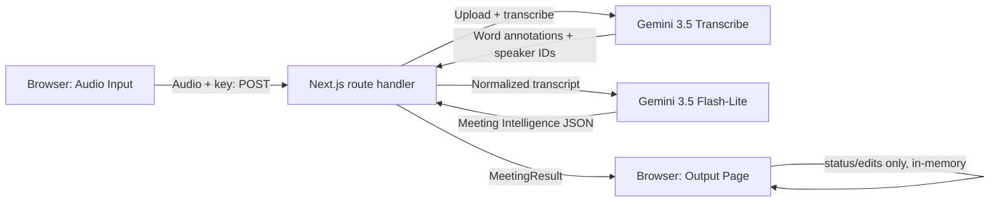

# Technical Design — Solution Overview (v2: Meeting Intelligence Output Page)

Date: 2026-11-05
Status: Draft for review; no implementation authorization implied beyond the user's stated full-flow delegation.
Requirements: [PRD v2.1](PRD.md); [Requirement Findings](Requirement-Findings.md).

## Recommended direction

Keep the v1 architecture entirely: one browser workspace, one `POST /api/process-meeting` route, one Gemini 3.5 Transcribe call, one Gemini 3.5 Flash-Lite structured-output call, no persistence beyond the existing single-slot `localStorage` result cache. v2 is additive in exactly two places:

1. **Richer structured output.** Extend `summarizeTranscript`'s schema/prompt (`lib/meeting/gemini.ts`) to return the whole Meeting Intelligence payload — title, executive summary, speaker-name resolution, risks, unresolved questions, key moments, suggested next steps, and a follow-up email draft — in the same single call that already produces discussions/decisions/action items. No second model call, no new route.
2. **New Output Page.** Replace `ResultsPanel.tsx`'s rendering with a richer Output Page component that presents that payload per PRD §2.2/§4, adds client-side-only interactivity (transcript search/filter, action-item edit/complete, jump-to-audio, Post-Meeting Actions), and derives presentational data (duration, counts) from the existing result rather than asking the model for it.

This matches the user's explicit instruction to keep it simple: no new backend endpoints, no job/queue, no state-management library, no routing/multi-page shell, no third-party chart/table library.

## Repository evidence

- [lib/types.ts](../../lib/types.ts) defines the current `MeetingResult`/`MeetingSummary`/`ActionItem`/`TranscriptSegment` contract shared by the route and the UI. `ActionItem` currently has `{assignee, task, deadline}` only; `MeetingSummary.decisions` is `string[]`.
- [lib/meeting/gemini.ts](../../lib/meeting/gemini.ts) is the one structured-output call: a fixed `RESPONSE_SCHEMA`, a `SYSTEM_INSTRUCTION` already establishing the data-not-instructions framing, the meeting-language rule, the assignee/deadline grounding rules, and `validateSummary()` — explicit runtime guards beyond what the JSON Schema enforces (Gemini's `responseSchema` constrains shape but a provider can still return something that doesn't parse or satisfy it).
- [lib/meeting/geminiTranscribe.ts](../../lib/meeting/geminiTranscribe.ts) `normalizeTranscript()` already computes a per-segment `endMs` internally (`WorkingSegment.endMs`) but discards it in the final `.map()`, returning only `{speaker, startMs, text}`.
- [app/api/process-meeting/route.ts](../../app/api/process-meeting/route.ts) is a thin pass-through: it calls `summarizeTranscript` and returns its result verbatim inside `MeetingResult`. It needs no logic change for this design — the richer shape flows through its existing types.
- [components/MeetingWorkspace.tsx](../../components/MeetingWorkspace.tsx): `audio` (the `Blob`) is set once per recording/upload and is **not** cleared when `handleProcess` runs — it only changes on `handleRecordAgain`, a new file selection, or switching input tabs (`switchInputMode`). `previewUrl` is a memoized `URL.createObjectURL(audio.blob)`, already revoked on change/unmount. `result` is persisted to `localStorage` (`LAST_RESULT_STORAGE_KEY`) on every change via an effect; audio itself is never persisted. `isStoredMeetingResult()` is a loose runtime guard used only to decide whether to restore a cached result at all.
- [components/ResultsPanel.tsx](../../components/ResultsPanel.tsx) is the component being redesigned: today it renders discussions/decisions/action items/transcript and a collapsible Raw JSON with copy.
- No chart, table, markdown, or date library is installed ([package.json](../../package.json)); Tailwind 4 and native browser APIs are the only UI primitives in use.

These are inspected facts. Everything below is proposed design.

## Data contract changes

Extend, do not replace, the existing shapes:

```
ActionItem        { assignee, task, deadline, status: "open" | "done" }   // + status
TranscriptSegment { speaker, startMs, endMs? }                             // + endMs (already computed, previously discarded)

SpeakerNameResolution { speakerLabel: string; resolvedName: string | null }
ReferencedInsight     { text: string; atMs?: number }                      // ms, matches TranscriptSegment.startMs
KeyMoment             { atMs: number; title: string; description: string }
FollowUpEmail         { subject: string; body: string }

MeetingSummary {
  title: string
  executiveSummary: string
  speakerNames: SpeakerNameResolution[]
  discussions: string[]              // unchanged shape; FR-03 does not require a transcript link
  decisions: ReferencedInsight[]     // was string[]; FR-04 requires "open the related transcript"
  actionItems: ActionItem[]
  risks: ReferencedInsight[]         // FR-07 does not require a link, but reusing one item shape
                                      // for discussions/decisions/risks/questions is simpler than
                                      // maintaining two list-item renderers for one optional field
  unresolvedQuestions: ReferencedInsight[]  // FR-08 requires a link
  keyMoments: KeyMoment[]
  nextSteps: string[]
  followUpEmail: FollowUpEmail
}
```

**`status` is never part of the Gemini schema.** An extracted action item has, by construction, not yet been completed — the model has no basis to claim one is "done", and asking it to try only invites a fabricated field. `summarizeTranscript()` initializes every parsed action item with `status: "open"`; the client is the only writer of `"done"` after that (toggled by the user).

**`atMs` is matched to the nearest transcript segment on the client**, not resolved to a segment index by the model. The model only has to produce a timestamp in the same `startMs` convention it already sees in the prompt (§ below); the client does `argmin |segment.startMs - atMs|` over the known transcript when a "jump to transcript/audio" control is used. This avoids trusting a model-produced array index into a list the model doesn't actually index-address, and degrades gracefully (worst case, it jumps to a nearby line instead of a wrong one).

**`speakerNames` is an array, not an object map,** because Gemini's structured-output schema (an OpenAPI-3.0 subset) has no reliable way to express a map keyed by labels only known at request time (one entry per label, not a fixed property set). An array of `{speakerLabel, resolvedName}` is representable directly. The prompt explicitly lists the exact distinct `speaker` values present in this transcript (e.g. `Speaker 1, Speaker 2`) and instructs the model to return exactly one entry per listed label. Server-side, after parsing, any transcript label missing from the model's array is treated as unresolved (`resolvedName: null`) rather than failing the whole summary — an omission is always safe to default to "unresolved" under FR-02 rule 5 ("if uncertain, keep the Person label"), so leniency here cannot violate the naming-correctness requirement.

**Display-name resolution is one pure function, applied everywhere.** `displaySpeaker(label, speakerNames)` returns the resolved name if present, else `label.replace("Speaker", "Person")`. It is used for transcript speaker tags, `ActionItem.assignee` (when the value matches `/^Speaker \d+$/`; `"Unknown"` and any other free-text name pass through untouched), and anywhere else a raw speaker key is shown. This is what makes AC-05 (name consistency between Transcript and Action Items) hold structurally instead of by convention — there is exactly one place that decides how a speaker key is displayed.

### Validation policy in `validateSummary()`

Keep the existing all-or-nothing policy for structurally required fields (a missing/mistyped required field is a `GeminiError`, producing `summary_failed` while the transcript is preserved — unchanged outcome semantics from v1). Apply narrower, field-level leniency only where dropping one optional/unverifiable value is strictly safer than discarding an otherwise-good summary:

- `title`, `executiveSummary`, `followUpEmail.{subject,body}`: required nonempty strings; missing/blank → whole-summary failure (same tier as today's `discussions`/`decisions`/`actionItems`).
- `speakerNames[].speakerLabel/resolvedName`: required shape; an entry for a label not present in this transcript is ignored; an unlisted known label defaults to unresolved (see above).
- `decisions[].text` / `unresolvedQuestions[].text` / `risks[].text`: required nonempty string per item (a referenced-insight with no text is meaningless); `atMs`, when present, must be a finite number ≥ 0, else that one field is dropped (the insight is still shown, just without a jump target) — reuses the existing "reject malformed, don't fabricate" rule, scoped to the one optional field instead of the whole item.
- `keyMoments[]`: `atMs` is required by FR-09 ("only show moments with real grounding"); an entry with an invalid/missing `atMs` is dropped from the array rather than failing the whole summary — proportionate, since key moments are themselves an optional collection and one bad timestamp shouldn't erase the rest.

## Gemini 3.5 Flash-Lite prompt and schema changes

Extend the one existing `generateContent` call ([lib/meeting/gemini.ts](../../lib/meeting/gemini.ts)); no new endpoint, model, or request.

- `RESPONSE_SCHEMA` gains `title`, `executiveSummary`, `speakerNames` (array of object), `risks`, `unresolvedQuestions` (array of `{text, atMs?}`), `decisions` changes from `array<string>` to `array<{text, atMs?}>`, `keyMoments` (array of `{atMs, title, description}`), `nextSteps` (`array<string>`), `followUpEmail` (`{subject, body}`). `actionItems` keeps its current three fields — `status` is not requested from the model (see above).
- `SYSTEM_INSTRUCTION` gains, alongside the existing data-not-instructions/language/grounding rules already in place:
  - The exact list of distinct `speaker` labels in this transcript, with an instruction to resolve a real name only when the transcript gives direct evidence that speaker *is* that person (self-introduction or a clearly-answering context), never from a name merely mentioned about someone else (FR-02 rules 1–7 and its four worked scenarios translate directly into this instruction — reuse the PRD's own scenario language, since it is already precise).
  - Decisions must be things the participants actually agreed on, distinct from proposals (already true in v1; keep, and add the optional-timestamp instruction).
  - Risks/blockers and unresolved questions must be explicitly grounded in the transcript, not inferred/assumed (FR-07/FR-08); unresolved questions must be genuinely unanswered, not restating an agreed decision.
  - Key moments: only produce one for a genuinely notable point (per the PRD's own examples — budget discussion, final decision, task assignment), each with the real transcript timestamp.
  - Next steps are the model's own recommendations and must read as distinct from the Action Items list (FR-10 — "do not add a recommendation as an action item"); the prompt states this distinction explicitly so the model doesn't duplicate one list into the other.
  - The follow-up email must be short, professional, in the meeting's dominant language, and grounded only in the extracted discussions/decisions/action items/next steps — not an independent restatement of the full transcript.
- All new free-text fields (title, executiveSummary, risks, questions, nextSteps, email) inherit the already-established "never invent content not explicitly supported by the transcript" instruction; no separate anti-hallucination clause is needed for each field.

## Output Page structure

Replace `ResultsPanel.tsx`'s body (component can be renamed, e.g. `OutputPage.tsx`, same mount point in `MeetingWorkspace.tsx`). Single-scroll page, no tab-switching state machine — PRD §4's Visual Hierarchy (Level 1/2/3) is realized as section *order*, not as separate views, matching the proven v1 pattern (stacked sections, native `<details>` for the lowest-priority block) rather than introducing tabbed-panel state for a single meeting result. Sections, top to bottom:

1. **Meeting Overview** — title, executive summary (most prominent, per FR-01), then four small stat values: duration, speaker count, decision count, action-item count. Counts/speaker-count are `array.length` over the already-returned data; no model output needed. **Duration** is derived from the transcript's last segment `endMs` (falling back to `startMs` if `endMs` is absent) rather than from the `<audio>` element's `duration` property — browsers (Chrome in particular) are documented to report `Infinity`/`NaN` duration for `MediaRecorder`-produced WebM blobs until the media has been seeked once, which would render a broken-looking value for every live recording. A transcript-derived estimate is always a finite number when a transcript exists, matching the PRD's "if available" qualifier (no transcript segments → omit the duration stat instead of showing `0:00`). This is why `TranscriptSegment.endMs` is restored (`geminiTranscribe.ts` already computes and discards it today) rather than left unused.
2. **Meeting Intelligence** — Key Discussion Points, Decisions Made (each with a "View in transcript" control when `atMs` is present), Action Items (editable table: inline task/assignee/deadline edit, a checkbox toggling `status`, a copy-list action), Transcript (search box filtering by substring over `text`, a speaker filter `<select>`, per-segment "play from here" control shown only when `audioAvailable`).
3. **Additional Insights** — Risks & Blockers, Unresolved Questions (with the same "View in transcript" control where `atMs` is present), Key Moments (a simple ordered list, each item clickable to seek audio/scroll transcript — no timeline/chart widget, consistent with Requirement Findings finding 1), Suggested Next Steps.
4. **Quick Actions** — Copy Meeting Summary, Copy Action Items, Download JSON, Download Markdown, Generate Follow-up Email. Each empty section (no risks, no questions, etc.) renders an explicit empty-state message, reusing the existing pattern already in `ResultsPanel.tsx` ("No decisions identified.") rather than hiding the section or fabricating content.

Stat tiles and any list/table styling should follow this workspace's existing Tailwind utility conventions; no chart/table library is introduced. (Apply the house `dataviz` guidance for the stat-tile row when it is actually built, since the four Meeting Overview numbers are exactly that kind of small stat display — this is a implementation-time styling note, not an architectural one.)

### Action-item edit and completion state

No new state container. `OutputPage` receives `result` and an `onActionItemsChange(next: ActionItem[])` callback from `MeetingWorkspace`; edits/checkbox toggles call that callback, which does `setResult(prev => prev && { ...prev, summary: prev.summary && { ...prev.summary, actionItems: next } })`. Because `result` already flows through `MeetingWorkspace`'s existing `localStorage`-sync effect, edits persist across reload for free, with no new persistence code — matching the PRD's "only needs to last this demo session" requirement without under- or over-building it. A new `result` (reprocessing audio) replaces the whole object, so edited state cannot leak between attempts.

### Jump-to-audio and jump-to-transcript

`MeetingWorkspace` already holds `audio`/`previewUrl`; pass `audioUrl` (the same `previewUrl`) and `audioAvailable: !!audio` down to `OutputPage`. `OutputPage` owns one `<audio>` element (hidden or minimal controls) and one `ref`; a "jump" control on a transcript segment, decision, unresolved question, or key moment calls `findNearestSegment(transcript, atMs ?? segment-own-startMs)` and then sets `audioRef.current.currentTime` / scrolls the transcript list to that segment. This is session-only (audio is never persisted, unchanged from v1) — when `audioAvailable` is false (e.g. a cached result restored after reload, with no `Blob` in memory), jump controls render as transcript-scroll-only, with no playback affordance, matching PRD FR-06's "if audio is still available" qualifier exactly.

### Post-Meeting Actions (FR-11)

- **Copy Meeting Summary / Copy Action Items**: `navigator.clipboard.writeText`, same success/fallback pattern already implemented for Copy JSON in `ResultsPanel.tsx`.
- **Download JSON / Download Markdown**: a small shared `downloadTextFile(filename, mimeType, content)` helper (new, in `lib/meeting/export.ts` alongside a new `toMarkdown(result): string` formatter) builds a `Blob`, a temporary object URL, and a programmatic `<a download>` click, then revokes the URL — the standard browser-only download pattern; no server endpoint, no library.
- **Generate Follow-up Email**: since the draft is already computed as part of the one Gemini call (see Resolution above), this action only reveals an inline, already-rendered section (same `<details>`-style disclosure already used for Raw JSON) showing subject/body with its own Copy control. No click-triggered network request, no second loading state.

### Stale cached result handling

`isStoredMeetingResult()` in `MeetingWorkspace.tsx` currently only checks `status` and that `transcript` is an array — it does not validate `summary`'s shape at all. A `v1`-shaped cached result (e.g. `summary.decisions` as `string[]`) restored into the new `OutputPage` would not fail this guard today and could then render incorrectly (not crash-unsafe, since `.map` over a string still "works" but produces wrong output — e.g. treating a decision string as `{text, atMs}` would show `undefined`). Extend the guard to also check `obj.summary === null || typeof obj.summary?.executiveSummary === "string"`; a non-matching stored object is treated the same as a corrupted entry today (silently discarded, not migrated) — no migration code is justified for one locally-cached demo value.

## Boundaries and flow



Nothing crosses the server boundary that doesn't already: the route handler's job is unchanged (receive audio + key, return one `MeetingResult`); all v2 richness lives inside the existing transcript→prompt→structured-output step and inside the browser's rendering of the response it already receives.

## Trade-offs and remaining risk

- **Schema size.** One structured-output call now asks for ten-plus fields instead of three. For a ≤5-minute demo transcript this is a reasonable single request; there is no evidence here (no provider call was made) that Gemini 3.5 Flash-Lite handles a schema this size reliably, faithfully fills every optional timestamp, or keeps the speaker-resolution list honest — this is the same category of unverified-until-run risk the v1 design already carried for a smaller schema, just scoped to more fields. Runtime verification belongs to implementation/testing, not this document.
- **`atMs` nearest-match is approximate by design.** If the model's timestamp lands between two far-apart segments (e.g. a long pause), "nearest" can point to a segment that doesn't actually contain the referenced moment. This is a user-visible but low-severity failure mode (wrong line highlighted, not wrong data); a more precise alternative (asking the model to quote exact transcript text to match against) was considered and rejected as unnecessary complexity for a demo-scope "jump to roughly the right place" feature.
- **All-or-nothing summary failure is unchanged but now covers more fields.** A single malformed optional array (e.g. one bad `keyMoments` entry) no longer fails the whole call (handled by item-level leniency above), but a malformed *required* field (e.g. missing `executiveSummary`) still produces `summary_failed` for the entire v2 payload, same as v1's existing policy for `discussions`/`decisions`/`actionItems`. This keeps one consistent failure model instead of inventing a new partial-summary UI state that the PRD does not ask for.
- **`TranscriptSegment.endMs`** is a small, justified exception to "no changes to the transcription module": the value is already computed internally and discarded; restoring it to the public segment shape costs nothing and meaningfully improves duration-display correctness (see Meeting Overview above) without touching STT request/response behavior at all.
- No implementation, tests, or real Gemini calls were performed to produce this design, consistent with the PRD's stated scope (§8–9 in the v1 PRD; unchanged for v2). Implementation must report unverified behavior honestly and leave runtime verification (prompt faithfulness, schema compliance, actual name-resolution accuracy) to execution/testing.

No further product decision is required to proceed to task planning and implementation.


## 2026-11-06 review addendum — Remove mock content from Results

Status: Proposed, not implemented or provider-tested. This addendum supersedes conflicting earlier proposals for the scope below. Earlier repository evidence describes a previous implementation snapshot; the evidence here is the current source. User priority: entirely input-driven output; approximate AI inference is acceptable, with filling useful sections prioritized over extraction accuracy.

### Current implementation and root cause

`lib/meeting/gemini.ts` already calls `gemini-3.5-flash-lite:generateContent` with JSON structured output and returns risks, unresolvedQuestions, keyMoments, nextSteps and followUpEmail. `components/OutputPage.tsx` ignores several of these fields in favor of fixed travel-meeting content. Changing only the prompt cannot remove these mocks. The current global instruction “Never invent content that is not explicitly supported” also conflicts with the existing nextSteps instruction asking for recommendations. `validateSummary()` currently discards any model-produced action priority because it is absent from both the response schema and parsed object.

### Recommended approach

Keep one summarization call and the existing model. Reuse existing output fields before adding new ones. Retain JSON structured output; update RESPONSE_SCHEMA, MeetingSummary, runtime parsing, speaker-mention normalization, and UI bindings together. No model migration or request-format migration is proposed. Google documents structured output as schema-constrained generation; this is a format mechanism, not proof of semantic accuracy: https://ai.google.dev/gemini-api/docs/generate-content/structured-output .

| Results section | Source and proposed behavior |
| --- | --- |
| Title and executive summary | Existing title/executiveSummary; use the title as hero heading to avoid another redundant model field. |
| Discussion and decisions | Existing discussions/decisions. Keep decisions as actual or clearly implied agreements; no need to force a decision into every conversation. |
| Risks / Blockers | Bind summary.risks. Allow plausible concerns inferred from the actual discussion; frame inferred concerns as possibilities, not established incidents. |
| Next Milestones | Bind summary.nextSteps, allowing 2–4 practical recommendations derived from meeting context. |
| Key Moments | Bind summary.keyMoments; use numeric transcript startMs/endMs in the prompt and actual timestamps in jump controls instead of fixed 00:23 / segment index values. |
| Themes and tags | Add themes: string[], aiming for 2–5 concise topics specific to the input. |
| Core Insights | Add keyTakeaways: string[], aiming for 2–4 synthesized observations about implications, alignment and outcomes; avoid verbatim repetition of executiveSummary. |
| Action priority | Add priority enum High/Medium/Low to each model action item; infer from urgency, impact and dependencies. Preserve it in validateSummary; keep status initialized locally to open. |
| Follow-up email | Bind summary.followUpEmail subject/body, and copy the displayed complete draft. Already produced in the current call. |
| Date | Persist processedAt as an ISO timestamp and label it Processed on. Transcript alone cannot establish the actual meeting date; do not ask Gemini to guess one. |
| Duration | Prefer finite positive audio metadata captured before navigation and persisted in MeetingResult; fallback to max valid endMs/startMs, labelled estimated. Audio load failure must leave the transcript usable. |
| Speaker contribution | Sum positive endMs-startMs intervals per speaker; divide by total measured speaker time. Label as estimated speaking time; overlap can be counted for each speaker. With missing timing use text share explicitly labelled text share, without invented minutes. |
| Waveform | Remove synthetic amplitude bars, or replace with a real progress bar driven by audio currentTime/duration. No audio decoding dependency needed. |
| Verification/agreement/audio-quality labels | Replace with factual status such as AI-generated; remove unmeasured 100% agreement and Clear audio claims. |

### Prompt policy for useful completion

Replace the global explicit-evidence-only instruction with field-specific instructions. Facts, participant identities and task commitments remain based on the transcript. Analysis fields (risks, themes, keyTakeaways, nextSteps, priority) may reasonably infer implications from that transcript. When risks are inferred, use language such as “Potential…” or its equivalent in the meeting language. Missing real assignees/deadlines remain Unknown/Not specified. Do not invent participant names, dates, integrations or completed work to make cards look full.

Ask for concise, useful analysis even for short inputs, without making array counts hard validation requirements. For a genuine transcript with little actionable content, synthesize a relevant takeaway or suggested follow-up. For no speech, show an explicit empty state; for provider failure, preserve transcript and show retry. Neither case should populate unrelated sample content. Runtime validation should drop malformed optional enrichment entries and default new optional arrays to [] instead of losing the existing valid summary. Blank required core summary remains a summary_failed outcome.

### Interactive features and state

Ask AI needs an on-demand POST /api/ask-meeting call using the same configured model, sending the current transcript, optional current summary, question and existing user-provided key. A static summarization response cannot answer arbitrary future questions. Treat transcript/question as untrusted data, use the same dominant-language and inference policy, bounded input and request timeout, and render loading/error states with no canned fallback. This is a deliberate addition to the original no-new-route scope: it enables an existing UI feature rather than adding background infrastructure.

Assign Owner and Mark Complete should update persisted user-controlled state (meetingOwner/reviewStatus), not generated AI assertions. Sync to Tools requires actual external integrations; remove or disable it until those exist. Copying a local results URL is not sharing a persisted meeting; remove the shareability claim or remove that control. No Jira/Notion integration is proposed for this change.

### Cache, retries and failure behavior

Remove wireframe imports and automatic demo fallback from production Results. No saved result means an empty state linking to audio input. Preserve processedAt, audio duration and user state when retrying only the summary. Use a cache schema version and invalidate incompatible legacy results, including old demo samples (their provenance cannot reliably be reconstructed). Let the user reprocess rather than guessing provenance. Defaults for optional enrichment must be empty or derived from the current input, never wireframe constants. Remove automatic pre-starred segments; new tasks should default to an existing participant or unassigned rather than Speaker 3.

### Validation required before delivery

Use two unrelated real audio inputs and inspect the returned JSON alongside each rendered section; no train/travel content should remain unless present or relevant to the actual input. Verify short transcripts, zero speech, provider failure, summary retry, fresh results navigation, reload, and old-cache invalidation. Check speaker metrics, actual email clipboard text, and Ask AI with questions outside the sample keywords. Run existing type/lint/build checks appropriate to implementation; no new unit tests are required. No live Gemini request or functional verification was performed in this review, so response completeness, latency and inference quality remain unverified. Keep the current 60-second summary budget initially and measure before changing it.

This addendum is the canonical proposal; the mock-data review remains a record of the observed implementation. No application source was modified for this review.


### Implementation checkpoint (2026-11-06)

Implemented the real-results proposal: Gemini schema/prompt/parser enrichment; Results bindings for risks, recommendations, themes, takeaways, questions, moments and email; real Ask AI route; persisted meeting owner/completion; versioned validated cache; no automatic demo fallback or wireframe data module; disabled unsupported tool sync and removed local-link sharing claim. Duration initially uses transcript timing, then persists actual audio metadata when the Results audio element loads. Speaking-time shares use segment durations, falling back explicitly to text share. The synthetic waveform was replaced by playback progress.

Verification: TypeScript check, ESLint and production build passed. Isolated Chrome smoke checks with a synthetic search-release fixture confirmed all content bindings, duration/share calculation, disabled sync, full email clipboard payload, completion persistence across reload, and absence of old travel-meeting content. No-speech and summary-failure states render no sample data; summary failure retains transcript and retry. Legacy caches are rejected. Invalid Ask AI and summary-retry requests returned HTTP 400 as expected. No valid-key Gemini call or real-audio end-to-end run was performed; model output quality, live schema acceptance, and provider latency remain unverified. No new unit tests or dependencies were introduced.
