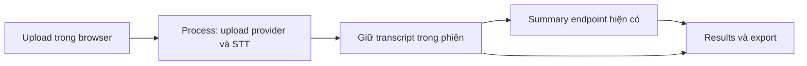

# Technical Design — v3: Large audio demo

Ngày: 2026-11-06. Trạng thái: phương án được chọn cho planning theo chỉ dẫn ưu tiên đơn giản; chưa triển khai hoặc benchmark. Nguồn: [PRD](PRD.md), [Findings](Requirement-Findings.md).

## Hướng giải pháp

Giữ một app Next.js local, provider và model hiện có. Tách luồng browser thành hai request nối tiếp: phiên âm trả transcript → giữ kết quả trong memory → gọi endpoint summary hiện có. Không thêm job server, polling, queue, database, audio chunking hoặc model call nhiều tầng.

`process-meeting` hiện dùng `formData()`, helper upload gọi `arrayBuffer()`, nên tăng giới hạn lên 100 MiB vẫn có các bản sao buffer trong server. Chấp nhận cho một lượt demo local; không tuyên bố constant-memory hoặc hỗ trợ production. Không base64 hoặc decode toàn bộ audio trong browser; dùng Blob/object URL và metadata audio. Nếu đo thấy memory không phù hợp, báo rủi ro/ngưỡng chưa đạt trước khi cân nhắc streaming, không tự thêm hạ tầng.

## Bằng chứng và các thành phần ảnh hưởng

- [constants](../../lib/constants.ts), [validation](../../lib/validateAudio.ts): dùng chung giới hạn upload/recording; phải tách giới hạn byte của recording khỏi upload để không vô tình tăng scope ghi âm.
- [process route](../../app/api/process-meeting/route.ts) hiện có budget STT 180s, cleanup 10s, summary 60s và trả `schemaVersion: 3`.
- [STT helper](../../lib/meeting/geminiTranscribe.ts) dùng Gemini Files rồi Interactions foreground, chuẩn hóa word annotations; giữ request/schema provider hiện tại, không giả định provider hỗ trợ chunk/resume bổ sung.
- [summary helper](../../lib/meeting/gemini.ts), [summary route](../../app/api/summarize-meeting/route.ts): có thể tái sử dụng cho request thứ hai và retry.
- [Ask AI](../../app/api/ask-meeting/route.ts) đã chặn serialized transcript >200.000 ký tự; dùng cùng cách tính cho summary, chưa cần mở rộng context.
- [stored result](../../lib/meeting/storedResult.ts) chỉ chấp nhận ba trạng thái terminal hiện có; thêm trạng thái trung gian phải cập nhật validator và consumers đồng bộ.
- [audio session](../../lib/meeting/audioSession.ts) là mẫu handoff module memory có sẵn; áp dụng cùng nguyên tắc cho kết quả, không thêm state library.

Đã đọc guide Next.js cài tại `node_modules/next/dist/docs/01-app/01-getting-started/15-route-handlers.md` và `03-api-reference/03-file-conventions/02-route-segment-config/maxDuration.md`: Route Handlers dùng Web Request/Response, POST không cache; `maxDuration` chỉ là thông tin platform có thể dùng. Không dùng một config này để hứa hosting sẽ cho request chạy dài. `next.config.ts` bật cacheComponents; tránh thêm runtime/dynamic config theo quán tính.

## Contract và trạng thái cần thay đổi

Đây là contract **đề xuất**, chưa phải hành vi endpoint đang có:

- Giữ `POST /api/process-meeting` multipart `audio`, `geminiApiKey`. Chỉ thực hiện upload/STT/cleanup, trả envelope hiện tại với `status: transcribed`, `transcript`, `summary: null`, metadata, warnings. No speech trả `no_speech`. Bỏ summary call ở route này.
- `transcribed` nghĩa là transcript đầy đủ đã sẵn sàng, chưa có summary; không dùng `summary_failed` để mô tả lúc đang chờ. Bổ sung state này vào type, validator, cache và UI; giữ version 3 vì additive và không đổi field cũ. Consumer mới tiếp tục đọc cache terminal version 3 hiện có.
- Giữ `POST /api/summarize-meeting` JSON `{transcript, geminiApiKey}` và response hiện tại. Browser merge `completed` hoặc `summary_failed` vào cùng transcript, không thay duration, processedAt, warnings hoặc user edits. No speech không gọi summary.
- Chặn summary/Ask AI nếu `JSON.stringify(transcript).length > 200000`, trả lỗi validation rõ ràng trước model call. Summary UI đánh dấu không hỗ trợ kích thước này, không lặp retry; transcript giữ nguyên. Exact limit 200000 được phép.
- Input quá byte dùng HTTP 413; input thiếu/sai format dùng 400; provider thất bại dùng 502, timeout dùng 504. Summary có transcript hợp lệ nhưng AI thất bại tiếp tục trả outcome `summary_failed` như hiện tại. Client đọc JSON lỗi và fallback nếu response không phải JSON.
- Mọi response có `Cache-Control: no-store`. Không trả key, provider upload URL hoặc payload lỗi thô có thể lộ dữ liệu.

Đổi contract process là thay đổi nội bộ, cần cập nhật route/client trong cùng lần triển khai; không hứa tương thích với caller ngoài app. Không đổi model hoặc wire format provider trong scope này. Nếu provider trả output truncated/noncompleted, báo lỗi; không tự suy ra completeness chỉ từ status hoặc timestamp cuối.

## Budget, kết quả đến muộn và tài nguyên

- Browser giữ một `attemptId`, AbortController, và deadline toàn lượt 15 phút kể từ Process; upload/STT tối đa 12 phút kể từ lúc bắt đầu request đầu. Server có deadline upload-provider/STT tối đa 12 phút kể từ nhận request. Browser vẫn là giới hạn bao gồm thời gian upload tới local server; khi abort phải truyền tín hiệu xuống helper provider nếu khả thi.
- Summary budget 120s, giới hạn tiếp bởi thời gian còn lại của deadline tổng ở client. Cleanup best effort budget 10s, hoàn tất trước trả transcript; tổng thời gian không được khiến browser chờ vượt deadline.
- Khi abort, không tuyên bố provider inference đã ngừng. Server dùng finally cleanup resource đã biết với signal riêng và budget riêng. Nếu upload thất bại trước khi nhận resource ID thì không thể bảo đảm xóa; cảnh báo rõ, không giữ request vô hạn.
- Mọi async response/side effect client kiểm tra attemptId trước cập nhật memory, cache hoặc điều hướng. Khóa Process/retry trong lượt hiện tại. Không tự retry network/model; không bổ sung exactly-once guarantee qua nhiều tab.
- UI chỉ có giai đoạn upload/phiên âm kết hợp và summarizing, elapsed time. Không cần SSE để có progress đẹp; có transcript ngay ở request boundary là đủ.

## Bảo toàn kết quả và transcript dài

Tạo handoff memory cho latest result, cập nhật trước khi cache/điều hướng; Results đọc memory trước localStorage. Với kết quả mới, nếu ghi cache thất bại, xóa best effort cache cũ để hạn chế reload nhầm và hiện cảnh báo export. Nếu không xóa được cache cũ, cảnh báo reload có thể khôi phục kết quả trước đó. Không thể cam kết recovery khi storage bị chặn hoàn toàn.

Checkpoint `transcribed` được lưu best effort, nên reload sau STT có thể hiển thị transcript và nút tạo summary; không tự tiếp tục request hoặc tự gọi AI lại. Refresh giữa STT không phục hồi được. Memory reset khi full reload, audio cũng vậy. Cache validator hiện có phải chấp nhận trung gian `summary: null` và UI cần render phù hợp. Không thay cơ chế lưu API key hiện tại.

Phân trang transcript 100 đoạn/trang, search/filter trên toàn mảng trước phân trang, reset trang khi thay query/filter; jump tính vị trí trong danh sách phù hợp và mở đúng trang, xóa filter nếu nó che đoạn đích. Không thêm virtualization dependency. Export duyệt toàn dữ liệu gốc, không lấy danh sách đã phân trang. Thu gọn Raw JSON và chỉ serialize khi mở/download để tránh xử lý lặp ở render.

## Phương án khác và điều kiện nghiệm thu

Chỉ tăng timeout/byte giữ một request sẽ đơn giản hơn nhưng không đáp ứng giữ transcript tại browser trước summary. Job/queue giải quyết recovery nền nhưng vượt scope. Chia audio hoặc tóm tắt nhiều tầng cần xử lý speaker/context/dedup nên để ngoài demo; giới hạn text rõ ràng thay thế cho việc cắt ngầm.

Rủi ro còn lại: giới hạn thực provider, tốc độ mạng/quota, buffering RAM, STT bỏ sót dù báo completed, transcript vượt text cap. Chạy file chuẩn và file ~60 phút theo Test Specification để xác nhận. Chưa có bằng chứng live; kiến trúc không bảo đảm mọi audio 60 phút đều có summary trong text cap. Nếu fixture bắt buộc vượt cap hoặc thất bại, nghiệm thu chưa đạt và phải ghi nhận thay vì gọi đó là thành công toàn flow.
